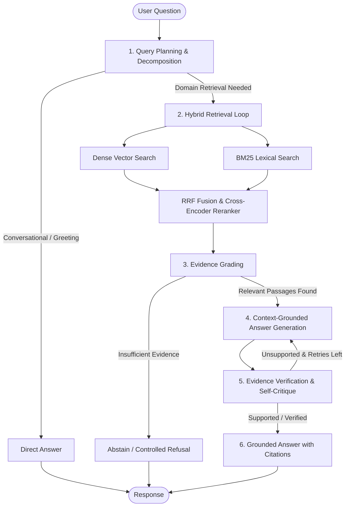

<div align="center">

# Agentic RAG Platform

**Production-grade, document-grounded question answering powered by LangGraph multi-agent orchestration, hybrid retrieval, cross-encoder reranking, and self-verifying hallucination guards.**

[](https://www.python.org/)
[](https://fastapi.tiangolo.com/)
[](https://langchain-ai.github.io/langgraph/)
[](https://qdrant.tech/)
[](https://react.dev/)
[](https://www.typescriptlang.org/)
[](https://vitejs.dev/)
[](#testing--verification)

</div>

---

## Overview

The **Agentic RAG Platform** is an enterprise-grade retrieval-augmented generation system engineered to resolve multi-part domain questions (e.g., medical billing guidelines, insurance policies, denial codes) with zero hallucination drift. 

Unlike conventional naive RAG pipelines, queries are executed through an autonomous **LangGraph state machine** that decomposes complex intents, executes targeted multi-step hybrid retrieval loops, grades evidence relevance, synthesizes context-grounded answers, and performs a dedicated **self-reflection verification check** before returning responses with verifiable passage citations.

```
agentic-rag-platform/
├── backend/    FastAPI service — LangGraph agent, hybrid retrieval, ingestion pipeline, eval harness
└── frontend/   React 19 + TypeScript + Vite SPA — document management, chat, evaluations, admin
```

---

## Core Capabilities

* **LangGraph Agentic Orchestration:** Stateful cyclic workflow featuring query decomposition, dynamic routing (retrieval vs. direct response), evidence grading, iterative multi-turn retrieval, and hard recursion bounds.
* **Self-Reflection & Hallucination Mitigation:** Dedicated verification node grades answer faithfulness against retrieved passages. Answers are stamped with explicit verification statuses (`supported`, `partially_supported`, `unsupported`, `skipped`) or dynamically routed to controlled abstention paths.
* **Two-Stage Hybrid Retrieval & Reranking:** Dense semantic vectors (**BGE-small** in Qdrant) combined with sparse lexical search (**BM25**) fused via **Reciprocal Rank Fusion (RRF)** and filtered through a **Cross-Encoder Reranker** (`bge-reranker-base`).
* **Transactional Document Ingestion (ETL):** Supports PDF, TXT, and DOCX documents with deterministic `uuid5` content-hash chunking, metadata extraction, batched embedding generation with backoff retries, and transactional vector store rollbacks on failure.
* **Quantitative Evaluation Framework (RAGOps):** Built-in benchmarking harness measuring **NDCG@k, MRR, Hit Rate@k, Precision@k, Recall@k, and Answer Token-F1** across golden datasets with configurable quality threshold gates.
* **Multi-Tenant Security & Production Hardening:** Native Qdrant tenant payload isolation, composite SQL indices, SQLite foreign key enforcement, constant-time authentication, IDOR mitigation, sliding window context management, and dual-probe health monitoring.

---

## Agentic Workflow



---

## System Architecture

```
Client (React 19 + Vite + Tailwind CSS + TanStack Query)
   │
   ▼ HTTP / REST (Bearer JWT Auth)
FastAPI Backend Application
   ├── API Routers (/auth, /users, /documents, /query, /conversations, /feedback, /evaluations, /health)
   ├── Security & RBAC (Argon2id, Constant-Time Comparison, IDOR Protection)
   ├── Service Layer (QueryService, DocumentService, EvaluationService, AuthService)
   ├── Agent Core (LangGraph State Graph, Tool Nodes, Context Window Manager)
   ├── Retrieval Engine (Dense Retriever, BM25 Engine, RRF Fusion, Cross-Encoder Reranker)
   ├── Ingestion Pipeline (PDF/DOCX/TXT Extractors, Recursive Chunking, Embeddings Worker)
   └── Persistence Layer
         ├── SQL Database: SQLite / PostgreSQL (SQLAlchemy 2.0 Async, Composite Indices)
         └── Vector Database: Qdrant (Payload Indexes, Tenant Scoping, Cosine Distance)
```

---

## Tech Stack

| Layer | Technology | Purpose |
|---|---|---|
| **Agentic Framework** | **LangGraph**, LangChain Core | Cyclic graph execution, state management, tool calling |
| **LLM Inference** | **Groq API** (`openai/gpt-oss-20b`) | Ultra-fast token generation for planning and synthesis |
| **Vector Database** | **Qdrant** (`qdrant_local` embedded or remote server) | Dense semantic vector storage with payload filters |
| **Lexical Engine** | **BM25** (Rank-BM25) | Sparse keyword matching with precomputed token sets |
| **Embeddings & Reranking** | **Sentence-Transformers** (`bge-small-en-v1.5`, `bge-reranker-base`) | Semantic vectorization and cross-encoder relevance scoring |
| **Backend Framework** | **FastAPI**, Uvicorn, Pydantic v2 | Asynchronous REST API, validation, dependency injection |
| **ORM & Database** | **SQLAlchemy 2.0 Async**, Alembic (SQLite / Postgres) | Relational persistence, metadata management, composite indices |
| **Frontend Framework** | **React 19**, TypeScript, Vite | Modern single-page web client |
| **UI & Styling** | **Tailwind CSS**, Radix UI primitives, Lucide Icons | Responsive glassmorphism interface, dark/light themes |
| **State & Data Fetching** | **TanStack Query v5** | Live auto-polling, query caching, optimistic UI updates |

---

## Getting Started

### Prerequisites
* **Python:** 3.11 or higher
* **Node.js:** 18 or higher (v20+ recommended)
* **Groq API Key:** [Obtain a free key from console.groq.com](https://console.groq.com/)

---

### 1. Backend Setup

```bash
# Navigate to the backend directory
cd backend

# Create and activate virtual environment
python -m venv .venv
.venv\Scripts\activate                 # Windows PowerShell
# source .venv/bin/activate            # macOS / Linux

# Install dependencies in editable mode
python -m pip install -e ".[dev]"

# Configure environment variables
copy .env.example .env                 # Windows
# cp .env.example .env                 # macOS / Linux

# Open .env and insert your GROQ_API_KEY
# Run database migrations
alembic upgrade head

# Start the API server
python -m uvicorn app.main:app --reload --port 8000
```

* Swagger API Documentation: [http://127.0.0.1:8000/docs](http://127.0.0.1:8000/docs)
* Health Endpoint: [http://127.0.0.1:8000/api/v1/health](http://127.0.0.1:8000/api/v1/health)

---

### 2. Frontend Setup

```bash
# In a new terminal, navigate to the frontend directory
cd frontend

# Install dependencies
npm install

# Start the development server
npm run dev
```

* Web Application: [http://localhost:5173](http://localhost:5173)

> **Initial Admin Setup:** Register the first account at `/register` to automatically gain the **Workspace Administrator** (`admin`) role. Subsequent registrations default to standard `user`.
> 
> **Instant Demo Mode:** To bypass authentication for local testing, set `DISABLE_AUTH=true` in `backend/.env` and restart the backend. The UI will open straight to the dashboard.

---

## Configuration Reference

Key settings configurable via `backend/.env` (refer to `backend/.env.example` for full options):

| Variable | Default | Description |
|---|---|---|
| `GROQ_API_KEY` | *Required* | API key for Groq LLM inference |
| `GROQ_MODEL` | `openai/gpt-oss-20b` | LLM model identifier |
| `DATABASE_URL` | `sqlite+aiosqlite:///./data/app.db` | Async database URI (`sqlite` or `postgresql+asyncpg://...`) |
| `VECTOR_STORE` | `qdrant_local` | Vector engine: `qdrant_local` (embedded disk) or `qdrant` (server) |
| `EMBEDDING_PROVIDER` | `local` | `local` (Sentence-Transformers) or `huggingface` |
| `EMBEDDING_MODEL` | `BAAI/bge-small-en-v1.5` | Embedding model name |
| `RERANKER_ENABLED` | `false` | Enable cross-encoder reranking (`bge-reranker-base`) |
| `RETRIEVAL_TOP_K` | `5` | Number of final passages sent to the LLM |
| `RETRIEVAL_CANDIDATE_K` | `20` | Candidate passages retrieved per engine before RRF fusion |
| `MIN_RELEVANCE_SCORE` | `0.15` | Minimum relevance threshold before evidence triggers abstention |
| `AGENT_MAX_ITERATIONS` | `8` | Hard recursion limit for LangGraph cyclic execution |
| `DISABLE_AUTH` | `false` | Bypasses authentication for demo sessions |

---

## API Surface

Base URL: `/api/v1`

| Domain | Method | Endpoint | Description | Access |
|---|---|---|---|---|
| **Health** | `GET` | `/health` | Dual DB & Vector Store operational status | Public |
| **Auth** | `POST` | `/auth/register` | Register new account (first user is admin) | Public |
| | `POST` | `/auth/login` | Authenticate and obtain JWT token pair | Public |
| | `POST` | `/auth/refresh` | Refresh expired access token | Public |
| | `GET` | `/auth/me` | Fetch active user profile and permissions | Authenticated |
| **Users** | `GET` | `/users` | List users with pagination | `users:manage` |
| | `PATCH` | `/users/{id}` | Update user role or active status | `users:manage` |
| **Documents** | `GET` | `/documents` | List workspace documents with filters | `documents:read` |
| | `GET` | `/documents/stats` | Document counts and indexing metrics | `documents:read` |
| | `POST` | `/documents` | Upload and trigger asynchronous ETL ingestion | `documents:write` |
| | `PATCH` | `/documents/{id}` | Update document metadata (category, collection) | `documents:write` |
| | `DELETE` | `/documents/{id}` | Delete document and cascade delete vector chunks | `documents:delete` |
| **Query** | `POST` | `/query` | Execute agentic question answering | `query:execute` |
| | `GET` | `/query/analytics` | Latency (p50/p95), abstention, and intent telemetry | `query:execute` |
| | `GET` | `/query/{id}` | Retrieve query turn, answer, and citations | `query:execute` |
| **Chat** | `GET` | `/conversations` | List multi-turn conversation threads | `query:execute` |
| | `GET` | `/conversations/{id}` | Fetch thread history and sequential turns | `query:execute` |
| | `DELETE` | `/conversations/{id}` | Delete conversation thread | `query:execute` |
| **Feedback** | `POST` | `/feedback` | Submit thumbs up / down rating on an answer | Authenticated |
| **Evaluations**| `POST` | `/evaluations` | Trigger offline evaluation run on dataset | `evaluations:run` |
| | `GET` | `/evaluations` | List evaluation benchmark runs | `evaluations:run` |
| | `GET` | `/evaluations/{id}` | Detailed metrics breakdown (NDCG, MRR, F1) | `evaluations:run` |

---

## Role-Based Access Control (RBAC)

| Role | Permissions |
|---|---|
| `admin` | Full system access, user administration, document deletion, and evaluations |
| `document_manager` | Upload, edit metadata, delete documents, and execute queries |
| `evaluator` | Run offline evaluation benchmarks and execute queries |
| `user` | Query grounded knowledge base and view owned/public documents |

---

## Testing & Verification

The platform is backed by a comprehensive, fully green automated test suite across both backend and frontend layers:

### Backend Test Suite (85 / 85 Passing)
```bash
cd backend
pytest -v
```
* **Security & Routing:** Path traversal prevention, constant-time auth checks, IDOR verification, LangGraph abstention routing (`test_phase1_security.py`, `test_agent_routing.py`).
* **Retrieval & Storage:** Qdrant multi-tenant filters, BM25 token optimization, RRF fusion, metadata sync (`test_phase2_retrieval.py`, `test_fusion.py`).
* **Pipeline & Ingestion:** Transactional rollback, chunk hashing, composite index queries (`test_phase3_production.py`, `test_documents.py`).
* **Observability & Resilience:** Health check dual-probes, evaluation fault tolerance, sliding conversational context (`test_phase4_observability.py`).

### Frontend Test Suite (22 / 22 Passing)
```bash
cd frontend
npm test               # Vitest component & unit tests
npm run typecheck      # TypeScript strict compilation check (0 errors)
npm run lint           # ESLint analysis (0 warnings)
npm run build          # Production bundle build (Vite)
```

---

## Offline Evaluation CLI

Run offline retrieval parameter sweeps to benchmark embedding models, rerankers, and top-k thresholds without starting the web server:

```bash
cd backend
# Build evaluation dataset from past queries
python scripts/build_eval_dataset.py --output data/eval/dataset.jsonl --limit 200

# Sweep retrieval configurations and print comparative benchmark table
python scripts/sweep_eval.py --dataset data/eval/dataset.sample.jsonl --modes "dense,bm25,hybrid,hybrid_rerank"
```

Output:
```
mode              recall@k    prec@k     mrr    ndcg@k   hit@k   items
----------------------------------------------------------------------
dense                0.820     0.450   0.780     0.795   0.880      50
bm25                 0.760     0.410   0.720     0.740   0.820      50
hybrid               0.885     0.520   0.840     0.865   0.940      50
hybrid_rerank        0.915     0.560   0.885     0.902   0.960      50
```

---

## License

Proprietary / MIT. All rights reserved.
